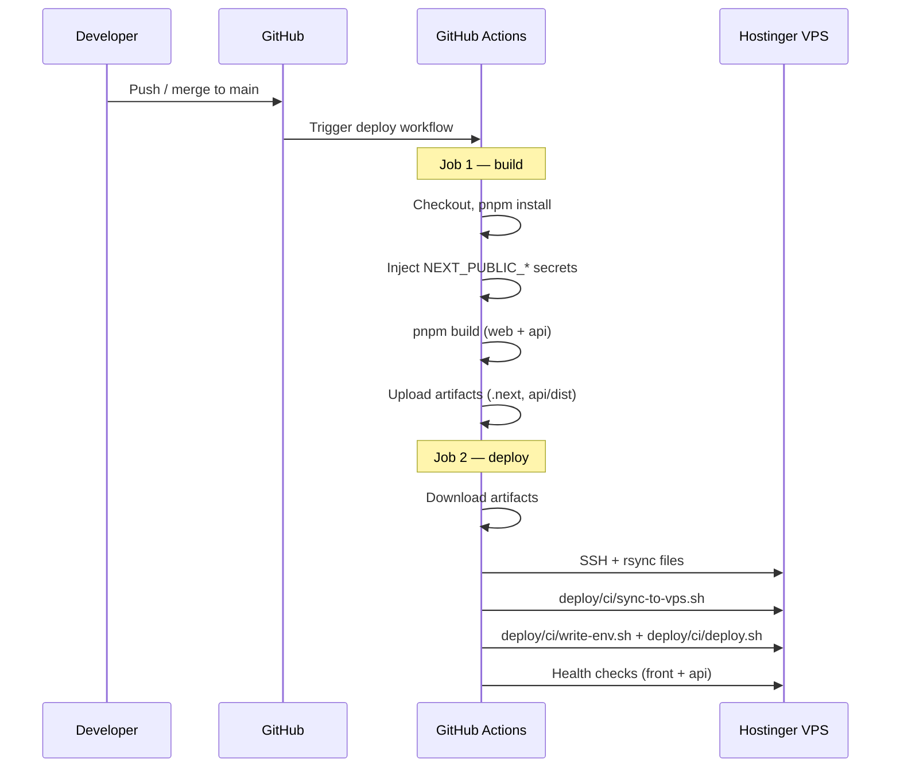

# Motake — Production Deployment Plan (Plan A)

**Architecture:** Frontend + API on **Hostinger VPS** · CI via **GitHub Actions**

This document is the end-to-end implementation plan for automated **full-stack** deployment to your VPS. Deployment scripts live under **`deploy/`** (see [`deploy/README.md`](deploy/README.md)).

---

## Table of Contents

1. [Architecture Overview](#1-architecture-overview)
2. [What Stays vs What Gets Added](#2-what-stays-vs-what-gets-added)
3. [End-to-End Flow](#3-end-to-end-flow)
4. [DNS & Domains](#4-dns--domains)
5. [GitHub Secrets & Variables](#5-github-secrets--variables)
6. [VPS One-Time Bootstrap](#6-vps-one-time-bootstrap)
7. [GitHub Actions Workflow](#7-github-actions-workflow)
8. [New CI Scripts (To Be Implemented)](#8-new-ci-scripts-to-be-implemented)
9. [Caddy — Full Stack (Front + API)](#9-caddy--full-stack-front--api)
10. [Required Code Changes](#10-required-code-changes)
11. [Environment Files by Environment](#11-environment-files-by-environment)
12. [Implementation Phases](#12-implementation-phases)
13. [Verification Checklist](#13-verification-checklist)
14. [Rollback](#14-rollback)
15. [FAQ](#15-faq)

---

## 1. Architecture Overview

```
┌─────────────────────────────────────────────────────────────────────────┐
│                    PRODUCTION (full stack on VPS)                       │
├─────────────────────────────────────────────────────────────────────────┤
│                                                                         │
│   User browser                                                          │
│        │                                                                │
│        ├──► https://motake-front.lunarstudio.dev                        │
│        │         Caddy TLS → PM2 → motake-web (Next.js) :3000          │
│        │                                                                │
│        └──► https://motake-back.lunarstudio.dev/trpc                    │
│                  Caddy TLS → PM2 → motake-api (Express + tRPC) :8000    │
│                                                                         │
│   Hostinger VPS  187.127.220.211  (srv1892671.hstgr.cloud)             │
│                                                                         │
└─────────────────────────────────────────────────────────────────────────┘

┌─────────────────────────────────────────────────────────────────────────┐
│                         LOCAL DEV (unchanged)                           │
├─────────────────────────────────────────────────────────────────────────┤
│   deploy/local/env-setup.sh  →  pnpm dev  (web :3000 + api :8000)       │
│   deploy/vps/deploy.sh       →  interactive full VPS deploy (same stack) │
└─────────────────────────────────────────────────────────────────────────┘
```

| Component | Where | How it deploys |
|-----------|--------|----------------|
| **Frontend** (`apps/web`) | Hostinger VPS | GitHub Actions → SSH → PM2 (`motake-web`) |
| **API** (`apps/api`) | Hostinger VPS | GitHub Actions → SSH → PM2 (`motake-api`) |
| **Database** | Supabase PostgreSQL | `DATABASE_URL` in GitHub Secrets |
| **Auth** | Supabase | Browser client (web) + service role (API) |
| **TLS** | Caddy on VPS | Both subdomains |
| **Reverse proxy** | Caddy | `motake-front` → :3000, `motake-back` → :8000 |

**Target VPS (Hostinger):**

| Field | Value |
|-------|--------|
| VPS ID | `1892671` |
| Hostname | `srv1892671.hstgr.cloud` |
| IPv4 | `187.127.220.211` |
| OS | Ubuntu 22.04 LTS |

---

## 2. What Stays vs What Gets Added

### Kept for developers (do not remove)

| File | Purpose |
|------|---------|
| `deploy/local/env-setup.sh` | Interactive local `.env` setup + symlinks |
| `deploy/vps/deploy.sh` | Interactive full VPS deploy (web + api + caddy) |
| `deploy/vps/caddy-setup.sh` | Interactive/non-interactive Caddy (full stack or API-only) |
| `deploy/pm2/start-api.sh` | PM2 wrapper for API |
| `deploy/pm2/start-web.sh` | PM2 wrapper for Next.js |
| `.env.example` | Template for all variables |

### New files (to implement in a follow-up task)

| File | Purpose |
|------|---------|
| `.github/workflows/deploy.yml` | GitHub Actions: build web + api → deploy to VPS |
| `deploy/ci/deploy.sh` | Non-interactive full-stack deploy (called by Actions or manually) |
| `deploy/ci/write-env.sh` | Writes `$VPS_APP_PATH/.env` from env vars (no prompts) |
| `deploy/ci/sync-to-vps.sh` | Rsync repo to VPS + run remote deploy (GHA runner) |
| `deploy/lib/common.sh` | Shared helpers used by vps/ and ci/ scripts |

> **Note:** `deploy/vps/deploy.sh` stays for manual/interactive deploys. `deploy/ci/deploy.sh` is the **non-interactive CI equivalent** — same outcome, no TTY prompts.

---

## 3. End-to-End Flow

### 3.1 On push/merge to `main`



### 3.2 What GitHub Actions does

- Builds **both** `apps/web` and `apps/api` on GitHub runners
- Deploys **both** to VPS via SSH
- Writes `.env` from Secrets (no interactive prompts)
- Runs Caddy setup for **both** domains (non-interactive)
- Restarts PM2 processes

### 3.3 What GitHub Actions does **not** do

- Does **not** prompt for user input
- Does **not** replace interactive scripts in `deploy/local/` and `deploy/vps/`
- Does **not** deploy to Vercel or any external PaaS

### 3.4 Developer local workflow (unchanged)

```bash
./deploy/local/env-setup.sh   # once — interactive .env
pnpm install
pnpm dev            # web + api locally
```

Optional manual production-like deploy on a server:

```bash
./deploy/vps/deploy.sh        # interactive — same stack as CI, with prompts
```

---

## 4. DNS & Domains

Configured in **Cloudflare** (zone: `lunarstudio.dev`):

| Record | Type | Target | Serves |
|--------|------|--------|--------|
| `motake-front.lunarstudio.dev` | A | `187.127.220.211` | Frontend (Caddy → PM2 web) |
| `motake-back.lunarstudio.dev` | A | `187.127.220.211` | API (Caddy → PM2 api) |

**Verified state (Aug 2026):**

- `motake-front.lunarstudio.dev` → `187.127.220.211` ✅
- `motake-back.lunarstudio.dev` → `187.127.220.211` ✅
- Both records: DNS only (not Cloudflare-proxied) — Caddy handles TLS on VPS

**No Vercel DNS changes needed.** Both subdomains stay on the VPS IP.

---

## 5. GitHub Secrets & Variables

Store in: **Repository → Settings → Secrets and variables → Actions**

GitHub Actions reads these automatically on every deploy — **replacing interactive input** from `deploy/local/env-setup.sh` and `deploy/vps/deploy.sh` in CI.

### 5.1 Secrets (encrypted — sensitive)

#### VPS / SSH

| Secret | Example / description |
|--------|------------------------|
| `VPS_HOST` | `187.127.220.211` or `srv1892671.hstgr.cloud` |
| `VPS_USER` | `deploy` (recommended) or `root` |
| `VPS_SSH_KEY` | Private key (full PEM content) |
| `VPS_APP_PATH` | `/var/www/motake` |

#### Application runtime (written to VPS `.env`)

| Secret | Maps to `.env` key |
|--------|---------------------|
| `DATABASE_URL` | `DATABASE_URL` |
| `JWT_SECRET` | `JWT_SECRET` |
| `SUPABASE_URL` | `SUPABASE_URL` |
| `SUPABASE_SERVICE_ROLE_KEY` | `SUPABASE_SERVICE_ROLE_KEY` |
| `R2_ACCOUNT_ID` | `R2_ACCOUNT_ID` |
| `R2_ACCESS_KEY_ID` | `R2_ACCESS_KEY_ID` |
| `R2_SECRET_ACCESS_KEY` | `R2_SECRET_ACCESS_KEY` |
| `R2_BUCKET_NAME` | `R2_BUCKET_NAME` |
| `R2_PUBLIC_BASE_URL` | `R2_PUBLIC_BASE_URL` |
| `R2_DOCUMENTS_BUCKET_NAME` | `R2_DOCUMENTS_BUCKET_NAME` (private PDF bucket, no public access) |

#### Build-time + runtime (web — baked into Next.js at CI build)

| Secret | Maps to `.env` key |
|--------|---------------------|
| `NEXT_PUBLIC_API_URL` | `https://motake-back.lunarstudio.dev/trpc` |
| `NEXT_PUBLIC_SUPABASE_URL` | Supabase project URL |
| `NEXT_PUBLIC_SUPABASE_ANON_KEY` | Supabase anon key |

#### API URLs

| Secret | Maps to `.env` key |
|--------|---------------------|
| `BASE_URL` | `https://motake-back.lunarstudio.dev` |
| `CORS_ALLOWED_ORIGIN` | `https://motake-front.lunarstudio.dev` |

> **Important:** `NEXT_PUBLIC_*` must be available in the **build job** so Next.js bakes them into the production bundle. They are also written to `.env` on the VPS for consistency.

#### Notification service (Spec K — `apps/notification` Docker container)

Separate secrets, so leaking one does not open the others. `NOTIFICATION_INTERNAL_API_KEY` switches the service on: unset, deploy skips the notification container (and Docker) with a warning; set, every secret below is required and deploy fails on a missing one. The container also gets the root `R2_DOCUMENTS_BUCKET_NAME` (above), which never switches the service on. They are written to `deploy/generated/notification.env` (mode 600) for the container, **not** to the root `.env` the API loads — except `NOTIFICATION_INTERNAL_API_KEY`, which the main API also needs (with `NOTIFICATION_URL`, written by the deploy).

| Secret | Purpose |
|--------|---------|
| `NOTIFICATION_INTERNAL_API_KEY` | Shared main API ↔ notification key (`openssl rand -hex 32`); not the JWT secret or Supabase key |
| `META_PHONE_NUMBER_ID` | WhatsApp Business phone number id (also written to the root `.env`: the main API checks a pasted token against it) |
| `META_APP_SECRET` | Meta app secret (webhook `X-Hub-Signature-256`) |
| `META_WEBHOOK_VERIFY_TOKEN` | Any long random string; the same value goes into the Meta webhook settings |
| `INNGEST_EVENT_KEY` | Self-hosted Inngest event key (`openssl rand -hex 16`) |
| `INNGEST_SIGNING_KEY` | Self-hosted Inngest signing key, hex with an even length (`openssl rand -hex 32`) |
| `NOTIFICATION_R2_ACCOUNT_ID` | Cloudflare account id (same value as `R2_ACCOUNT_ID`); the endpoint is built from it |
| `NOTIFICATION_R2_ACCESS_KEY_ID` | Read-only R2 token for the private Documents bucket only |
| `NOTIFICATION_R2_SECRET_ACCESS_KEY` | Its secret |

### 5.2 Variables (non-sensitive — repository variables)

| Variable | Value |
|----------|--------|
| `MOTAKE_FRONTEND_DOMAIN` | `motake-front.lunarstudio.dev` |
| `MOTAKE_API_DOMAIN` | `motake-back.lunarstudio.dev` |
| `MOTAKE_ROUTING_MODE` | `separate` |
| `MOTAKE_WEB_PORT` | `3000` |
| `MOTAKE_API_PORT` | `8000` |
| `MOTAKE_NOTIFICATION_PORT` | `8100` (optional; published on `127.0.0.1` only) |
| `MOTAKE_INSTALL_TARGET` | `system` |
| `NODE_ENV` | `production` |
| `LOGGER_LEVEL` | `error` |

### 5.3 Optional: GitHub Environment `production`

For extra protection (required reviewers, environment-specific secrets):

1. **Settings → Environments → New environment** → `production`
2. Add same secrets scoped to `production`
3. Reference in workflow: `environment: production`

---

## 6. VPS One-Time Bootstrap

Run **once** on `187.127.220.211` before the first GitHub Actions deploy.

### 6.1 System packages

```bash
# Node 22
curl -fsSL https://deb.nodesource.com/setup_22.x | sudo -E bash -
sudo apt install -y nodejs

# pnpm
corepack enable && corepack prepare pnpm@9.0.0 --activate

# PM2
npm install -g pm2

# Caddy
sudo apt install -y debian-keyring debian-archive-keyring apt-transport-https curl
curl -1sLf 'https://dl.cloudsmith.io/public/caddy/stable/gpg.key' | sudo gpg --dearmor -o /usr/share/keyrings/caddy-stable-archive-keyring.gpg
curl -1sLf 'https://dl.cloudsmith.io/public/caddy/stable/debian.deb.txt' | sudo tee /etc/apt/sources.list.d/caddy-stable.list
sudo apt update && sudo apt install caddy
```

### 6.2 Deploy user & directory

```bash
sudo useradd -m -s /bin/bash deploy
sudo mkdir -p /var/www/motake
sudo chown deploy:deploy /var/www/motake

# Add SSH public key to /home/deploy/.ssh/authorized_keys
# Store matching private key in GitHub Secret VPS_SSH_KEY
```

### 6.3 Firewall

```bash
sudo ufw allow OpenSSH
sudo ufw allow 80/tcp
sudo ufw allow 443/tcp
sudo ufw enable
```

### 6.4 PM2 startup

```bash
sudo -u deploy pm2 startup systemd -u deploy --hp /home/deploy
# Run the command PM2 prints, then:
sudo -u deploy pm2 save
```

### 6.5 First `.env` on VPS

Either:

- Run `./deploy/local/env-setup.sh` once interactively on the server, **or**
- Let the first GitHub Actions deploy write `.env` via `deploy/ci/write-env.sh`

---

## 7. GitHub Actions Workflow

**File to create:** `.github/workflows/deploy.yml`

### 7.1 Triggers

```yaml
on:
  push:
    branches: [main]
  pull_request:
    types: [closed]
    branches: [main]
  workflow_dispatch: {}
```

For PR merges, add a job condition: `if: github.event.pull_request.merged == true`

Optional path filters (deploy only when relevant files change):

```yaml
paths:
  - 'apps/**'
  - 'packages/**'
  - 'pnpm-lock.yaml'
  - '.github/workflows/deploy.yml'
  - 'deploy/ci/**'
  - 'deploy/**'
```

### 7.2 Jobs

#### Job 1: `build`

| Step | Command / action |
|------|------------------|
| Checkout | `actions/checkout@v4` |
| Setup Node 22 | `actions/setup-node@v4` |
| Setup pnpm | `pnpm/action-setup@v4` |
| Install | `pnpm install --frozen-lockfile` |
| Inject env | Export `NEXT_PUBLIC_*` from secrets |
| Build | `pnpm build` (turbo builds web + api) |
| Verify API | `test -f apps/api/dist/index.js` |
| Verify web | `test -d apps/web/.next` |
| Upload artifacts | `apps/api/dist`, `apps/web/.next`, `apps/web/public`, selected `node_modules` or full sync strategy |

**Build artifact strategy (choose one when implementing):**

| Strategy | Pros | Cons |
|----------|------|------|
| **A — Full repo rsync** | Simple; `next start` works | Larger transfer |
| **B — Artifacts only** | Smaller | Must sync `node_modules` for web on VPS or use standalone output |

**Recommended:** Strategy A for v1 — rsync repo + build outputs; run `pnpm install --prod` on VPS if needed.

#### Job 2: `deploy` (needs `build`)

| Step | Action |
|------|--------|
| Download artifacts / checkout | Full deployable tree |
| SSH setup | `webfactory/ssh-agent` + `VPS_SSH_KEY` |
| Rsync to VPS | `$VPS_APP_PATH` |
| Write `.env` | `deploy/ci/write-env.sh` via SSH |
| DB migrate | `pnpm db:migrate` in deploy/ci/deploy.sh |
| Deploy | `deploy/ci/deploy.sh --skip-build` |
| Sync | `deploy/ci/sync-to-vps.sh` from GHA runner |
| Caddy | via deploy/ci/deploy.sh → deploy/vps/caddy-setup.sh |
| Health checks | `curl` front + `curl` api `/health` |

### 7.3 Pseudocode workflow structure

```yaml
name: Deploy to VPS

on:
  push:
    branches: [main]
  workflow_dispatch:

jobs:
  build:
    runs-on: ubuntu-latest
    steps:
      - uses: actions/checkout@v4
      - uses: pnpm/action-setup@v4
      - uses: actions/setup-node@v4
        with:
          node-version: '22'
          cache: 'pnpm'
      - run: pnpm install --frozen-lockfile
      - name: Build production apps
        env:
          NEXT_PUBLIC_API_URL: ${{ secrets.NEXT_PUBLIC_API_URL }}
          NEXT_PUBLIC_SUPABASE_URL: ${{ secrets.NEXT_PUBLIC_SUPABASE_URL }}
          NEXT_PUBLIC_SUPABASE_ANON_KEY: ${{ secrets.NEXT_PUBLIC_SUPABASE_ANON_KEY }}
        run: pnpm build
      - uses: actions/upload-artifact@v4
        with:
          name: motake-build
          path: |
            apps/api/dist
            apps/web/.next
            apps/web/public
            deploy/
            scripts/
            package.json
            pnpm-lock.yaml
            pnpm-workspace.yaml
            apps/web/package.json
            apps/api/package.json

  deploy:
    needs: build
    runs-on: ubuntu-latest
    environment: production
    steps:
      - uses: actions/download-artifact@v4
        with:
          name: motake-build
      - name: Deploy to VPS via SSH
        env:
          VPS_HOST: ${{ secrets.VPS_HOST }}
          VPS_USER: ${{ secrets.VPS_USER }}
          # ... all secrets for write-env.sh + deploy-ci.sh
        run: |
          # rsync to VPS
          # ssh scripts/deploy-ci.sh --skip-build
```

---

## 8. CI Scripts (implemented)

All scripts live under `deploy/ci/`. See [`deploy/ci/README.md`](deploy/ci/README.md).

### 8.1 `deploy/ci/write-env.sh`

- **Input:** All secrets exported as environment variables by the workflow
- **Output:** `$VPS_APP_PATH/.env` (full monorepo env — same keys as `.env.example`)
- **No prompts**

Example output:

```env
PORT=8000
NODE_ENV=production
BASE_URL=https://motake-back.lunarstudio.dev
DATABASE_URL=...
JWT_SECRET=...
SUPABASE_URL=...
SUPABASE_SERVICE_ROLE_KEY=...
R2_*=...
LOGGER_LEVEL=error
NEXT_PUBLIC_API_URL=https://motake-back.lunarstudio.dev/trpc
NEXT_PUBLIC_SUPABASE_URL=...
NEXT_PUBLIC_SUPABASE_ANON_KEY=...
CORS_ALLOWED_ORIGIN=https://motake-front.lunarstudio.dev
```

Also creates symlinks (same as `deploy/local/env-setup.sh`):

- `apps/api/.env` → `../../.env`
- `apps/web/.env.local` → `../../.env`
- `packages/database/.env`, etc.

### 8.2 `deploy/ci/deploy.sh`

Non-interactive equivalent of `deploy/vps/deploy.sh`:

```
1. Validate .env exists
2. Resolve ports (3000 web, 8000 api — bump if busy)
3. Write deploy/runtime.env
4. Skip build if --skip-build (CI already built)
5. Write deploy/ecosystem.config.cjs
6. pm2 startOrReload (motake-api + motake-web)
7. deploy/vps/caddy-setup.sh --non-interactive --force
8. curl localhost health checks
```

Flags:

```bash
./deploy/ci/deploy.sh [--skip-build] [--skip-caddy] [--skip-migrate]
```

Environment variables (no prompts):

```bash
MOTAKE_ROUTING_MODE=separate
MOTAKE_FRONTEND_DOMAIN=motake-front.lunarstudio.dev
MOTAKE_API_DOMAIN=motake-back.lunarstudio.dev
MOTAKE_FRONTEND_PORT=3000
MOTAKE_API_PORT=8000
MOTAKE_INSTALL_TARGET=system
```

**Requires:** `CI=true` or `--ci` — fails if required env vars are missing.

### 8.3 `deploy/generated/ecosystem.config.cjs`

PM2 config for **both** processes (generated at deploy time):

```javascript
module.exports = {
  apps: [
    {
      name: 'motake-api',
      script: './deploy/pm2/start-api.sh',
      interpreter: 'bash',
      cwd: '/var/www/motake',
      autorestart: true,
    },
    {
      name: 'motake-web',
      script: './deploy/pm2/start-web.sh',
      interpreter: 'bash',
      cwd: '/var/www/motake',
      autorestart: true,
    },
  ],
};
```

### 8.4 `deploy/ci/sync-to-vps.sh`

Runs on the GitHub Actions runner: rsyncs the repo to the VPS, then SSHs in to run `write-env.sh` and `deploy.sh --skip-build`.

### 8.5 Folder layout

```
deploy/
├── README.md
├── lib/common.sh
├── local/env-setup.sh
├── vps/deploy.sh, caddy-setup.sh
├── ci/write-env.sh, deploy.sh, sync-to-vps.sh
├── pm2/start-api.sh, start-web.sh
├── caddy/Caddyfile.example
└── generated/          # runtime artifacts (gitignored)
```

---

## 9. Caddy — Full Stack (Front + API)

Caddy on VPS terminates TLS for **both** subdomains. Uses `deploy/vps/caddy-setup.sh` separate-domains mode.

### 9.1 Fragment (`deploy/generated/motake.caddy` → `/etc/caddy/sites/motake.caddy`)

```caddy
# motake — managed by caddy-setup.sh
# motake-domains: motake-front.lunarstudio.dev motake-back.lunarstudio.dev

motake-front.lunarstudio.dev {
	encode gzip zstd
	reverse_proxy localhost:3000
}

motake-back.lunarstudio.dev {
	encode gzip zstd

	# Meta WhatsApp webhook -> notification container (Spec K). Its /trpc and
	# /api/inngest are never proxied; the main API reaches it on 127.0.0.1.
	handle /webhooks/whatsapp* {
		reverse_proxy localhost:8100
	}

	handle {
		reverse_proxy localhost:8000
	}
}
```

### 9.1a Notification service (Spec K)

`apps/notification` runs as one Docker container (`motake-notification`): the Express app plus a self-hosted Inngest server, with Inngest state on the named volume `motake-inngest-data`. It publishes only `127.0.0.1:${MOTAKE_NOTIFICATION_PORT:-8100}`. The deploy builds the image on the VPS (`docker build -f apps/notification/Dockerfile .`) and replaces the container on every deploy (`docker stop -t 30` first, so an in-flight send can finish; dangling images are pruned after a healthy start); it is skipped while `NOTIFICATION_INTERNAL_API_KEY` (§5.1) is unset. It runs after PM2, Caddy and the api/web health checks: a notification failure leaves the API and web live and fails the deploy job loudly at the end.

- `ensure-production.sh` installs Docker only when `NOTIFICATION_INTERNAL_API_KEY` is set. It first rewrites the managed `/etc/sudoers.d/deploy-motake` (validated with `visudo -c`), so an existing VPS gains `/usr/sbin/usermod`, then adds the deploy user to the `docker` group. Until the next SSH login the deploy runs docker through `sg docker`.
- The main API gets `NOTIFICATION_URL=http://127.0.0.1:<port>`, `NOTIFICATION_INTERNAL_API_KEY` and `META_PHONE_NUMBER_ID` in its `.env`.
- **WhatsApp access token (Spec J-0).** Not an env value. The master copy is the Supabase Vault secret `motake_whatsapp_access_token` (override with `WHATSAPP_TOKEN_VAULT_SECRET_NAME`, the same value on both apps); the working copy is the file `WHATSAPP_TOKEN_FILE` inside the container (`/var/lib/motake-secrets/whatsapp-access-token`, mode 600). At start-up, every 5 minutes and right after a send hits a token error, the app syncs the file from Vault, which is the master copy: a Vault token that differs from the file's and passes one read-only Graph call is written to the file (even when the file's token still works, so a rotation always lands); a Vault token Meta refuses never replaces a working file token. An empty or missing file takes the Vault token without waiting for the check, so start-up never depends on Meta being reachable. Only with no token in the file or Vault does the container refuse to start (and restart until one is saved). A message that fails on the token stays `pending` (held) and is sent once a working token is in place. To change the token, paste it in the Fix access token dialog from the Admin banner ("Fix access token" on the banner every Admin page shows while the token is not working): Motake checks it with Meta, saves it to Vault and the app picks it up within seconds.

**Meta one-time setup** (WhatsApp Business account):

1. Create the access token (a permanent System User token, no expiry):
   1. Meta Business Suite → Business settings → Users → System users → **Add**: a name (e.g. `motake-notification`), role **Admin**.
   2. **Assign assets**: the Motake app (Full control) and the WhatsApp Business account (Full control).
   3. **Generate new token**: the Motake app, expiry **Never**, permissions `business_management`, `whatsapp_business_messaging` and `whatsapp_business_management`.
   4. Paste it in the Fix access token dialog from the Admin banner (or, before the main API is up, store it in Vault by hand in the Supabase SQL editor: `select vault.create_secret('<token>', 'motake_whatsapp_access_token', '{}');`). Never put it in an env file, a log or a ticket.

   Note the phone number id → `META_PHONE_NUMBER_ID`; app secret → `META_APP_SECRET`.
2. Subscribe the app to the WABA: `POST https://graph.facebook.com/v26.0/<WABA-ID>/subscribed_apps` with the token.
3. In the app's WhatsApp → Configuration, set the callback URL `https://<api-domain>/webhooks/whatsapp` and the verify token `META_WEBHOOK_VERIFY_TOKEN`; subscribe the `messages` field.
4. Create the message templates in WhatsApp Manager and wait for approval; then insert a matching `notification_templates` row per name/language/version with `verified = true` (nothing is sent for a template that is not in the table and verified).

Check: `curl -sf http://127.0.0.1:8100/health` on the VPS (200 when the database and the in-container Inngest server answer; 503 when either is down). Its `whatsappToken` field shows the token state at the last check (`ok`, `invalid`, `unavailable`) but never makes it unhealthy. It does not check R2 credentials; a missing setting stops the app at start-up, so `/health` does not answer at all.

### 9.2 Non-interactive invocation (from CI)

```bash
MOTAKE_ROUTING_MODE=separate \
MOTAKE_FRONTEND_DOMAIN=motake-front.lunarstudio.dev \
MOTAKE_API_DOMAIN=motake-back.lunarstudio.dev \
MOTAKE_FRONTEND_PORT=3000 \
MOTAKE_API_PORT=8000 \
MOTAKE_INSTALL_TARGET=system \
MOTAKE_UPDATE_ENV=no \
./deploy/vps/caddy-setup.sh --non-interactive --force
```

- Extends existing `/etc/caddy/Caddyfile` via `import sites/motake.caddy`
- Does **not** overwrite other domains on the server

---

## 10. Required Code Changes

### 10.1 Production CORS (critical)

**Problem:** `apps/api/src/server.ts` only enables CORS when `NODE_ENV !== "production"`.  
Frontend and API are on **different subdomains** (`motake-front` vs `motake-back`) — cross-origin CORS **must** work in production.

**Change:** Enable CORS in production with explicit frontend origin:

```typescript
const allowedOrigin = process.env.CORS_ALLOWED_ORIGIN;

if (env.NODE_ENV === "production" && allowedOrigin) {
  app.use(cors({ origin: allowedOrigin, credentials: true }));
} else if (env.NODE_ENV !== "production") {
  app.use(cors({ origin: true, credentials: true }));
}
```

Add `CORS_ALLOWED_ORIGIN=https://motake-front.lunarstudio.dev` to GitHub Secrets and VPS `.env`.

### 10.2 Cross-origin cookies / auth

The tRPC client uses `credentials: "include"`. Separate subdomains require:

- API cookies: `SameSite=None; Secure`
- CORS `credentials: true`
- `NEXT_PUBLIC_API_URL=https://motake-back.lunarstudio.dev/trpc`

Review `packages/services/auth` session cookie settings before go-live.

### 10.3 `NODE_ENV=production`

Use `production` (not `prod`) everywhere — API, logger, and Next.js expect the standard value.

---

## 11. Environment Files by Environment

| Variable | Local dev (`.env`) | VPS production (`.env` from Secrets) |
|----------|-------------------|--------------------------------------|
| `NEXT_PUBLIC_API_URL` | `http://localhost:8000/trpc` | `https://motake-back.lunarstudio.dev/trpc` |
| `NEXT_PUBLIC_SUPABASE_URL` | ✅ | ✅ |
| `NEXT_PUBLIC_SUPABASE_ANON_KEY` | ✅ | ✅ |
| `BASE_URL` | `http://localhost:8000` | `https://motake-back.lunarstudio.dev` |
| `PORT` | `8000` | `8000` |
| `NODE_ENV` | `development` | `production` |
| `DATABASE_URL` | ✅ | ✅ (secret) |
| `JWT_SECRET` | ✅ | ✅ (secret) |
| `SUPABASE_SERVICE_ROLE_KEY` | ✅ | ✅ (secret) |
| `R2_*` | ✅ | ✅ (secret) |
| `CORS_ALLOWED_ORIGIN` | optional | `https://motake-front.lunarstudio.dev` |

**Rules:**

- **Local:** `./deploy/local/env-setup.sh` (interactive)
- **Production CI:** GitHub Secrets → `deploy/ci/write-env.sh` → VPS `.env`
- **Never commit** `.env`

---

## 12. Implementation Phases

### Phase 1 — Prerequisites (you)

- [ ] Cloudflare: `motake-front` + `motake-back` → `187.127.220.211`
- [ ] VPS bootstrapped (Node 22, pnpm, PM2, Caddy, firewall 80/443)
- [ ] GitHub Secrets & Variables added (full list in §5)
- [ ] SSH key for `deploy` user in `VPS_SSH_KEY`

### Phase 2 — Code changes (developer)

- [x] Production CORS in `apps/api/src/server.ts`
- [ ] Cookie `SameSite` review for cross-subdomain auth
- [x] `deploy/ci/write-env.sh`
- [x] `deploy/ci/deploy.sh`
- [x] `deploy/ci/sync-to-vps.sh`
- [x] `.github/workflows/deploy.yml`

### Phase 3 — GitHub Actions

- [x] Create `.github/workflows/deploy.yml`
- [ ] Test with `workflow_dispatch` (manual trigger)
- [ ] Verify:
  - `https://motake-back.lunarstudio.dev/health`
  - `https://motake-front.lunarstudio.dev`

### Phase 4 — End-to-end verification

- [ ] Frontend loads at `https://motake-front.lunarstudio.dev`
- [ ] API health at `https://motake-back.lunarstudio.dev/health`
- [ ] Login flow works (Supabase + API session)
- [ ] tRPC calls succeed (no CORS errors)
- [ ] Push to `main` auto-deploys without manual steps

---

## 13. Verification Checklist

### After deploy (GitHub Actions)

```bash
curl -sf https://motake-back.lunarstudio.dev/health
# Expected: {"message":"tRPC server is healthy","healthy":true}

curl -sI https://motake-front.lunarstudio.dev | head -5
# Expected: HTTP/2 200

ssh deploy@187.127.220.211 'pm2 status'
# Expected: motake-api + motake-web online

ssh deploy@187.127.220.211 'sudo systemctl status caddy'
# Expected: active
```

### Browser checks

- Open `https://motake-front.lunarstudio.dev` — app loads
- DevTools → Network — tRPC calls go to `motake-back.lunarstudio.dev/trpc`
- No CORS errors on login

---

## 14. Rollback

### Full stack (VPS)

```bash
# Re-run previous successful workflow from GitHub Actions tab
# Or on VPS:
pm2 restart motake-api motake-web

# Restore previous artifact if kept (workflow should retain last N builds)
```

---

## 15. FAQ

### Can we store secrets in GitHub instead of interactive prompts?

**Yes.** That is the core of this plan. GitHub Secrets + Variables replace interactive prompts from `deploy/local/env-setup.sh` and `deploy/vps/deploy.sh` in CI. Local dev still uses the scripts under `deploy/`.

### Does GitHub Actions deploy both frontend and backend?

**Yes.** Both `apps/web` and `apps/api` are built on GitHub and deployed to the VPS via SSH + PM2.

### Do we use Vercel?

**No.** Everything runs on the Hostinger VPS.

### Where do the deploy scripts live?

All scripts are under **`deploy/`** — see [`deploy/README.md`](deploy/README.md) for the folder layout.

### What triggers redeploy?

Push or merge to `main`, or manual `workflow_dispatch`.

### What about database migrations?

Run in the deploy job using `DATABASE_URL` secret before PM2 restart. Fail the deploy if migration fails.

### Why did HTTPS timeout earlier?

DNS was correct but Caddy/PM2 were not running or ports 80/443 were blocked. Bootstrap + first CI deploy fixes this.

---

## Summary

| Layer | Tool | Trigger |
|-------|------|---------|
| Frontend + API | **GitHub Actions → SSH → VPS** | Push/merge to `main` |
| Process manager | **PM2** | `motake-api` + `motake-web` |
| TLS / reverse proxy | **Caddy** | Both subdomains on VPS |
| Secrets | **GitHub Secrets + Variables** | Injected at build + deploy |
| Local dev | **deploy/local/env-setup.sh + pnpm dev** | Manual |
| Manual prod deploy | **deploy/vps/deploy.sh** | Manual/interactive |

**Next step:** Configure GitHub Secrets/Variables (§5), bootstrap the VPS (§6), then push to `main` or trigger `workflow_dispatch`.
