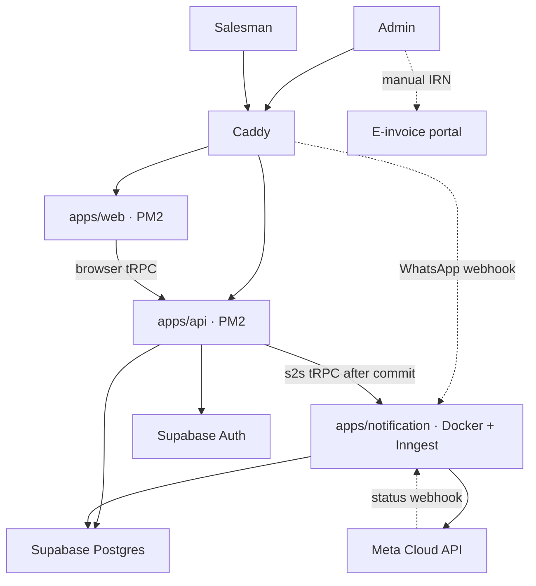
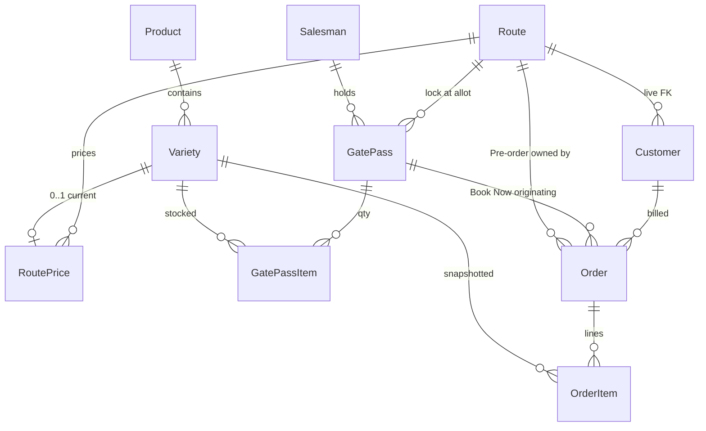
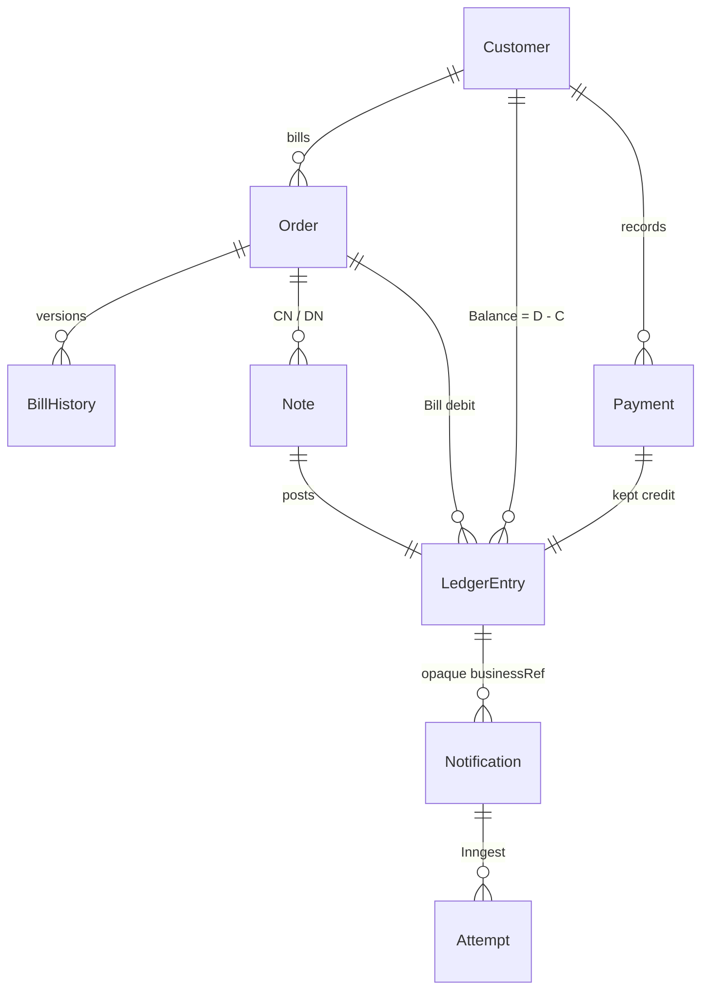

# Motake Sales — frozen system HLD

**Status:** frozen 2026-10-12. Specs and build tickets are a later map. Do not reopen seams here; change via a new ADR.

**Diagrams:** Cursor canvas `system-hld.canvas.tsx` (IDE canvases folder, not in git) is the live view. This file is the shareable freeze. If they drift, this file plus the ADRs win.

## Authority

1. `CONTEXT.md` — words.
2. `docs/adr/0003-route-replaces-company-wide-price.md` — Route replaces company-wide price and the shared Customer list.
3. `docs/adr/0002-ledger-concept.md` — Balance, ledger, Bill, Notes, GST, e-invoicing, paise.
4. `docs/adr/0001-notifications-package-single-contract.md` — WhatsApp transport boundary.
5. `docs/route-pricing-and-udhar.md` — Route, GatePass, ordering, end-to-end behaviour.

Maps: GitHub [#11](https://github.com/Lunar-Studio-Dev/motake-sales/issues/11) (Route), [#5](https://github.com/Lunar-Studio-Dev/motake-sales/issues/5) (WhatsApp engine).

Amendment in this freeze: Pre-order snapshots HSN, exemption and GST rate at **placement**. Fulfil does not re-tax. Bill still dated at fulfil. CA reviewed the earlier rate-at-fulfil draft — re-confirm if they object.

## Runtime

Web never calls the notification service or Meta. Domain commits on the main API first. Failed WhatsApp never rolls back a Bill, Payment, Note, or ledger entry.

## Package / tRPC seams

| Surface | Package | Router | Who |
| --- | --- | --- | --- |
| Route CRUD + Route price | `packages/services/routes` | `routes.*` on app router | Admin |
| GatePass allot (`routeId` required, then immutable) | `packages/services/gatepass` | `gatepass.*` | Admin |
| Customer list / add / move | `packages/services/customers` | `customers.*` | Salesman: Active GatePass Route. Admin: all |
| Variety (no money) | `packages/services/products` | `products.*` | Admin. Creating a variety does not copy prices |
| Book Now / Pre-order / fulfil | `packages/services/orders` | `orders.*` | Salesman places. Admin may fulfil Pre-order. No `salesman.routes` |
| Ledger / Notes / Bill History tables | later spec (ADR-0002) | named only | This HLD only joins Order = Bill |
| Enqueue + delivery | `packages/services` notification module | notification router on `apps/notification` | Internal API key. Not on the browser router |

Contract lives in `packages/trpc`. Shared DB models in `packages/database`.

## Selling ER

Customer has **no** `salesman_id`. Visibility is Active GatePass Route only. Owner is not a record.

- Route price: one current paise row per (Route, variety). Missing = unsellable. Edit overwrites. No dated list. Drop `product_varieties.unit_price`.
- Billed `orders` row **is** the Bill. Book Now immediately; Pre-order after fulfil.
- Book Now stores `gatepass_id`. Pre-order stores `route_id`, not `gatepass_id`.
- Bill freezes Route id, name, code, state, line prices, HSN, exemption, GST rate.

## Money and notifications ER

Dashed intent: ledger / Notes / Bill History / Payment tables are named in ADR-0002; table shape is a later spec.

Payment never matches a Bill. Balance is per Customer, not per Owner.

## Flows

**Active GatePass.** Admin allots with a Route. That Route is the only Customer list and price list the salesman sees. One Active GatePass per salesman. No Active GatePass → no bill, Pre-order, field Payment, or field-created Customer.

**Book Now** (atomic on place): validate GP + Customer Route + stock → snapshot prices → GST + round-off → deduct GatePass qty → Bill + History v1 → ledger debit + optional Payment → Balance cache → delegate notifications after commit.

**Pre-order.** Place: lock Route price, Route state, HSN, exemption, GST rate. No ledger, stock, or WhatsApp. Fulfil on/after scheduled date by any Active GatePass on that Route (or Admin). Reuse placement snapshots. Still no stock deduct. First writer wins.

**Notifications.** After domain commit, API builds a provider-neutral instruction (`kind`, `to`, content, `businessRef`, `idempotencyKey`) and delegates s2s tRPC. Notification service persists then acks a UUID. Inngest sends via Meta. Statuses: `pending` / `delivered` / `read` / `failed` / `skipped`.

## Later spec (not this freeze)

- Admin Route CRUD and price-list screen composition
- Seed contents (which Routes, prices, Customer-to-Route, opening balances, e-invoicing flags)
- Ledger / Notes / Bill History / Payment table DDL
- RLS, indexes, OpenAPI field lists
- PDF generation internals (callers pass immutable document URLs)

## Share pack

Send only these. Not `apps/`, `packages/`, `.cursor/plans/`, `PRD.md`, or `final.md`.

| File | Folder | Why |
| --- | --- | --- |
| `CONTEXT.md` | repo root | Words |
| `0001-notifications-package-single-contract.md` | `docs/adr/` | Notification boundary |
| `0002-ledger-concept.md` | `docs/adr/` | Money, GST, Bill |
| `0003-route-replaces-company-wide-price.md` | `docs/adr/` | Route decision |
| `route-pricing-and-udhar.md` | `docs/` | Product behaviour |
| `hld.md` | `docs/` | This freeze (diagrams + seams) |

GitHub (links, not files): [#11](https://github.com/Lunar-Studio-Dev/motake-sales/issues/11), [#5](https://github.com/Lunar-Studio-Dev/motake-sales/issues/5).
